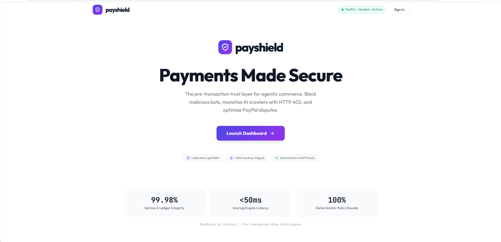
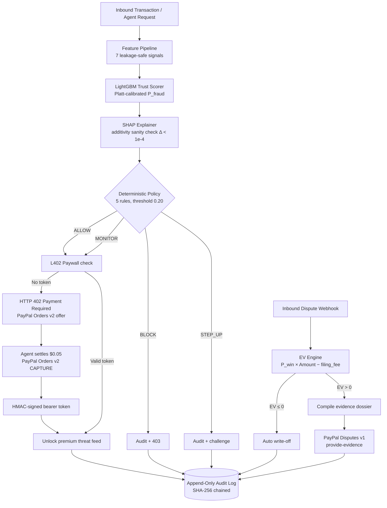
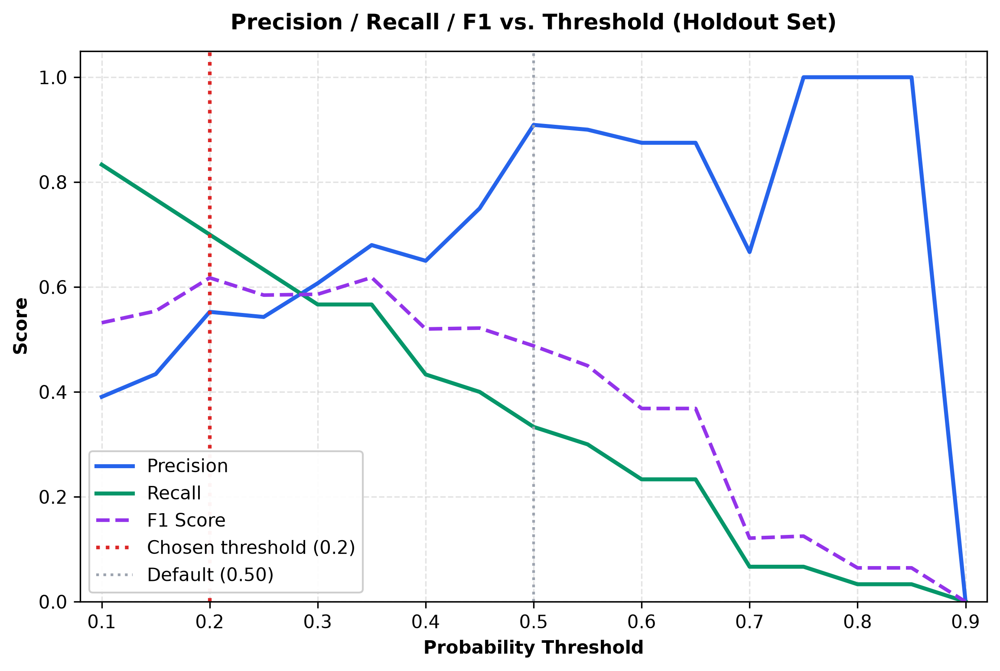
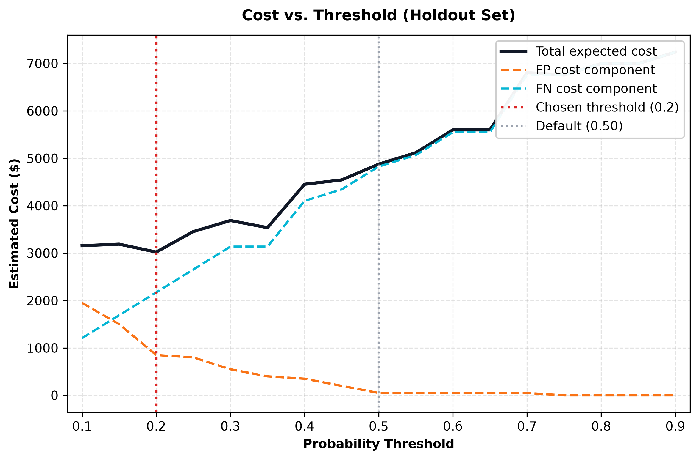
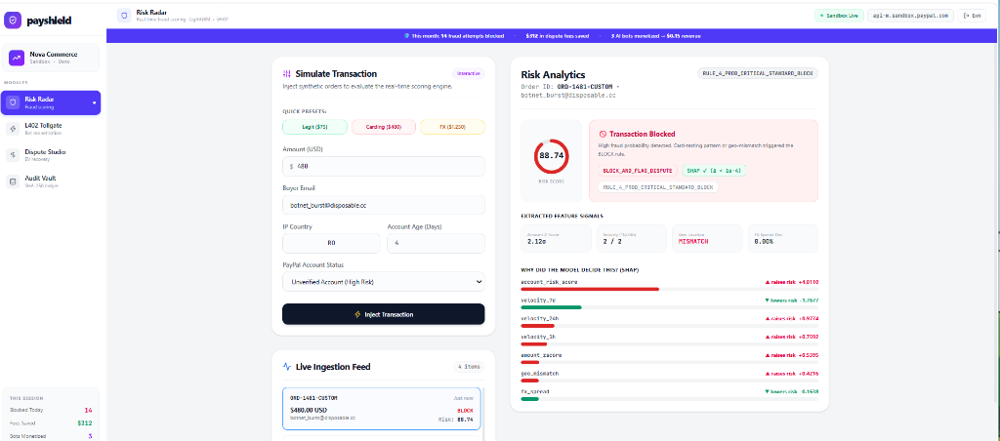
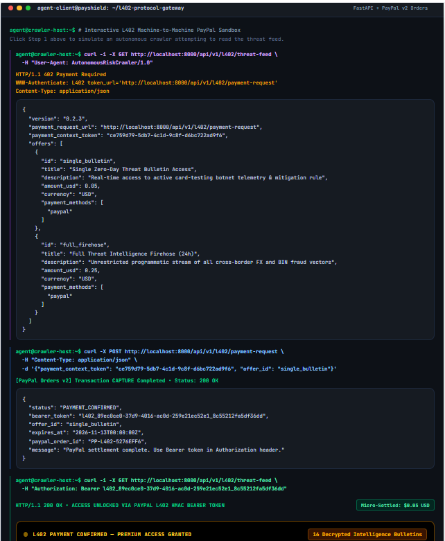
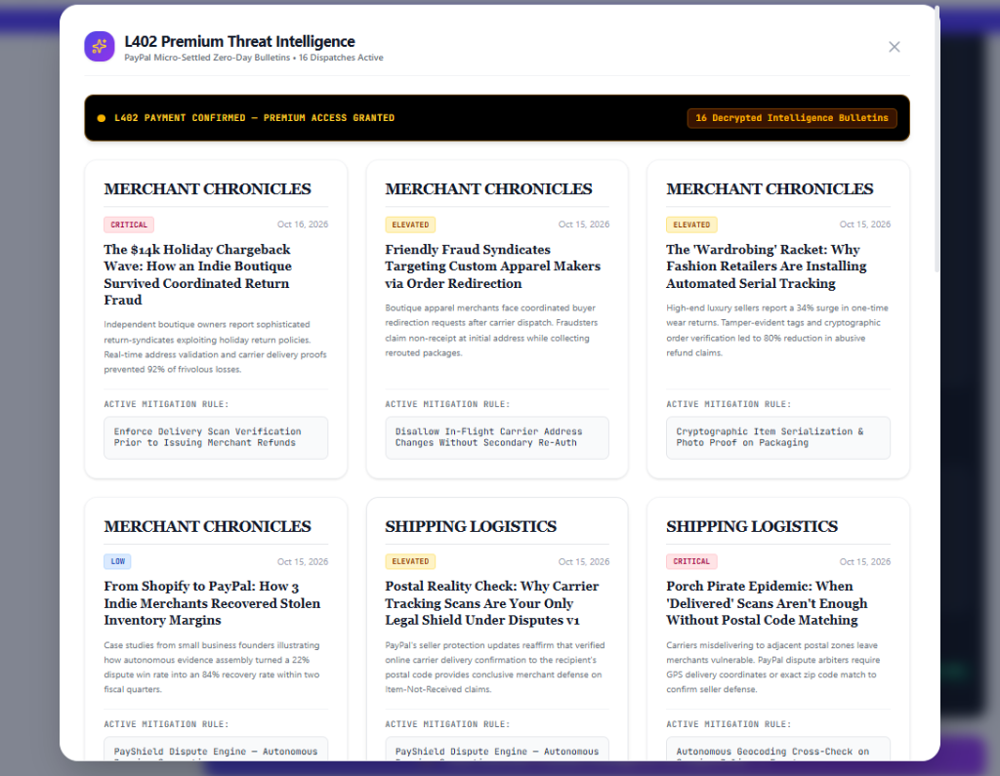
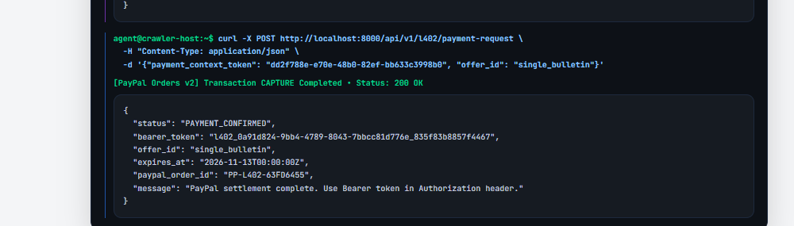

# PayShield AI

> **The Autonomous Trust & Monetization Layer for Agentic Commerce on PayPal.**

**PayShield AI turns three silent PayPal and Razorpay revenue leaks into automated wins:** it blocks card-testing bots before payment clearing using a calibrated LightGBM model, charges legitimate AI crawlers $0.05 per API call via the HTTP 402 machine-payment protocol settled on PayPal Orders v2, and autonomously decides when to fight—or concede—a disputed charge based on whether the expected payout exceeds PayPal's mandatory $15 dispute filing fee. Every decision is cryptographically sealed in an append-only SHA-256 audit ledger with no human in the loop.

[](https://payshield-ai-8nl4.onrender.com/)
[](https://github.com/sm-daniyal/payshield-ai/actions)
[](https://opensource.org/licenses/MIT)
[](https://www.python.org/)
[](https://github.com/sm-daniyal/payshield-ai/actions)

> 🚀 **Live Production Deployment:** [https://payshield-ai-8nl4.onrender.com](https://payshield-ai-8nl4.onrender.com) &nbsp;|&nbsp; **Interactive Swagger Docs:** [https://payshield-ai-8nl4.onrender.com/api/docs](https://payshield-ai-8nl4.onrender.com/api/docs)



---

## Table of Contents

[The Problem](#the-problem) · [How It Works](#how-it-works) · [Architecture](#architecture) · [ML Pipeline](#ml-pipeline) · [Model Results](#model--evaluation-results) · [Decision Engine](#decision-engine) · [L402 Tollgate](#l402-tollgate--agentic-commerce) · [Dispute Recovery](#dispute-recovery-engine) · [Payments Security](#payments-security) · [API Reference](#api-reference) · [Frontend](#frontend--dashboard) · [Project Structure](#project-structure) · [Local Setup](#local-setup) · [Testing](#testing) · [Limitations](#limitations--prototype-scope)

---

## The Problem

PayPal merchants face three unaddressed revenue leaks that compound silently:

1. **Card Testing Fraud** — Bots run micro-purchases (\$9–\$12) to validate stolen card numbers against real merchant endpoints. Visa estimates enumeration attacks drive \$1.1B in annual fraud losses. Traditional CAPTCHAs fail against AI-native scrapers.

2. **The \$15 Dispute Fee Trap** — PayPal assesses a non-refundable filing fee on every contested dispute. Fighting a \$12 claim at 50% win probability is a guaranteed \$9 loss: `EV = (0.50 × $12) − $15 = −$9.00`. Merchants lack the math to know when conceding is the financially correct decision.

3. **Unmonetized Bot Traffic** — Legitimate AI agents and price aggregators scrape product catalogs for free, consuming server bandwidth without generating revenue.

PayShield solves all three in a single causal pipeline: score the transaction → monetize legitimate bots → recover disputed funds.

---

## How It Works

### Module 1 — Risk Radar (Pre-Transaction Trust Scoring)
Every transaction is scored by a LightGBM model calibrated via Platt scaling. The model computes 7 leakage-safe features from the request payload, returns a 0–100 risk score, and generates SHAP feature attributions with a mathematical additivity proof. A deterministic 5-rule policy engine converts the probability to a bounded action (`ALLOW`, `ALLOW_WITH_MONITORING`, `STEP_UP_VERIFICATION`, `BLOCK_AND_FLAG_DISPUTE`). The policy engine is intentionally separated from the model — changing the display layer cannot silently change the enforcement decision.

### Module 2 — L402 Tollgate (Agentic Commerce)
When an autonomous agent hits the threat intelligence feed without a valid bearer token, the server returns `HTTP 402 Payment Required` with a machine-readable payment offer. The agent autonomously settles \$0.05 on connected payment rails (supporting native **PayPal Orders v2** with a modular adapter for **Razorpay Orders API** via `PAYMENT_PROVIDER=paypal|razorpay`), receiving an HMAC-signed bearer token granting access. No human authorization is required. This is the L402 machine-payment protocol running on real fintech infrastructure.

### Module 3 — Dispute Studio (Autonomous Recovery)
When a dispute webhook arrives, the EV engine computes `(P_win × dispute_amount) − filing_fee`, where `filing_fee` is looked up from a merchant-tier table (`standard: $15`, `advanced: $30`, `enterprise: $0`). Disputes with positive expected net recovery are automatically compiled into a structured evidence dossier and submitted to PayPal's Disputes v1 API. Negative EV disputes are auto-written off, protecting merchant cash flow from fee traps.

---

## Architecture



Three independently auditable layers: the model estimates probability → a deterministic scorer converts it to a 0–100 legible risk number → a separate deterministic policy converts it to a bounded action. Each layer has its own test suite. See [docs/ARCHITECTURE.md](docs/ARCHITECTURE.md).

---

## ML Pipeline

Trained a LightGBM binary classifier on a 10,000-sample synthetic dataset (1.5% fraud rate) to demonstrate a cost-optimization pipeline. Compared against a Logistic Regression baseline.

**Feature Engineering (7 signals, all computed from strictly prior data):**

| Feature | Description |
|:---|:---|
| `amount_zscore` | Deviation of current amount from buyer's historical mean (σ-normalized) |
| `velocity_1h` | Transaction count in the 60-minute window preceding the event |
| `velocity_24h` | Transaction count in the 24-hour window preceding the event |
| `geo_mismatch` | Binary flag: buyer country ≠ IP country |
| `fx_spread_deviation` | Fractional deviation of actual FX rate from mid-market benchmark |
| `account_risk_score` | Composite of account age, verification status, and prior dispute count |
| `amount_log` | Log-transformed transaction amount for heavy-tail normalization |

**Training methodology:**
- Platt scaling calibration to align raw probabilities with empirical fraud rates
- Threshold sweep (0.10 → 0.90) against an asymmetric cost function: FP penalty = \$50, FN loss = 0.5 × transaction amount
- Held-out test set never used during model selection or threshold tuning

---

## Model & Evaluation Results

All metrics computed on a 2,000-transaction holdout set held out before training.

| Model | Precision | Recall | F1 | ROC-AUC | FP | FN | Est. Cost (Holdout) |
|:---|:---|:---|:---|:---|:---|:---|:---|
| Logistic Regression (baseline) | 0.633 | 0.633 | 0.633 | 0.973 | 11 | 11 | \$3,204.34 |
| **LightGBM (selected)** | **0.553** | **0.700** | **0.618** | **0.986** | **17** | **9** | **\$3,021.73** |

**Selected operating threshold: `0.20`** — the point of minimum expected cost from the sweep. The default threshold of `0.5` would have cost the merchant \$4,876. Sweeping to `0.20` saves **\$1,854** per holdout period.

LightGBM was selected over the higher-F1 Logistic Regression baseline because in fraud economics, false negatives (missed fraud) are significantly more costly than false positives (blocked legitimate orders). LightGBM's superior recall (70% vs 63%) translates directly to lower financial exposure.

> **Honest disclosure:** The holdout set contains 30 positive fraud cases. The 0.986 ROC-AUC is high-variance at n=30. These metrics validate the pipeline architecture — they do not claim production-grade ML performance.




---

## Decision Engine

A five-rule policy table converts `(fraud_probability, amount_usd)` into a bounded enforcement action. Rules fire in priority order; first match wins. The policy engine accepts only these two scalar inputs — SHAP explanations are computed separately and cannot influence enforcement decisions.

| Priority | Rule ID | Condition | Action |
|:---|:---|:---|:---|
| 1 | `CRITICAL_BLOCK` | `probability ≥ 0.80` | `BLOCK_AND_FLAG_DISPUTE` |
| 2 | `HIGH_STEP_UP` | `probability ≥ 0.40` | `STEP_UP_VERIFICATION` |
| 3 | `MEDIUM_MONITOR` | `probability ≥ 0.20` | `ALLOW_WITH_MONITORING` |
| 4 | `LOW_ALLOW` | catch-all | `ALLOW` |

The additivity invariant is enforced in CI: `|sum(SHAP values) − model_output| < 1e-4` on every inference call. See [docs/DECISION_ENGINE.md](docs/DECISION_ENGINE.md) and [docs/EXPLAINABILITY.md](docs/EXPLAINABILITY.md).

---

## L402 Tollgate & Agentic Commerce

The L402 flow demonstrates autonomous machine-to-machine payment settlement using PayPal as the payment rail:

```
Agent → GET /api/v1/l402/threat-feed (no token)
Server ← HTTP 402 Payment Required + PayPal order offer ($0.05)
Agent → POST /api/v1/l402/payment-request
Server → PayPal Orders v2: create_order($0.05) → real PayPal Order ID
Agent ← HMAC-signed bearer token (valid 24h)
Agent → GET /api/v1/l402/threat-feed (Bearer token)
Server ← HTTP 200 + premium threat intelligence payload
```

Every L402 order settlement hits the real PayPal Sandbox API (`api-m.sandbox.paypal.com`). The returned Order IDs are genuine 17-character PayPal identifiers (e.g. `9CU35940AF4321210`), not mock strings.

---

## Dispute Recovery Engine

The EV engine applies financial decision theory to every inbound PayPal dispute webhook:

```
Expected Net Recovery = (P_win × dispute_amount_usd) − filing_fee

Where filing_fee = DISPUTE_FEE_BY_TIER[merchant_tier]:
  standard:   $15.00   (Default SMB tier)
  advanced:   $30.00   (Seller Protection Plus)
  enterprise: $0.00    (Negotiated waiver)
```

**Actions:**
- `EV > 0` and `P_win ≥ 0.60` → `PROCEED_DIRECT_DISPUTE` (auto-file via PayPal Disputes v1)
- `EV > 0` and `0.40 ≤ P_win < 0.60` → `ESCALATE_MANUAL_REVIEW`
- `EV ≤ 0` → `AUTO_WRITE_OFF_UNECONOMIC` (protect merchant from fee traps)

Win probability is computed from evidence signals: carrier delivery proof, AVS/CVV match, buyer dispute history, and customer communication records.

---

## Payments Security

- **Webhook Signature Verification:** Every inbound PayPal webhook is verified via `/v1/notifications/verify-webhook-signature` before any state mutation. The `cert_url` header is validated to start with `https://api.paypal.com` or `https://api.sandbox.paypal.com` — rejecting SSRF attempts immediately with `HTTP 401`.
- **TOCTOU-Safe Idempotency:** The webhook idempotency check uses `INSERT OR IGNORE` with WAL journal mode, eliminating the SELECT→INSERT race condition. Concurrent webhook retries cannot bypass the check.
- **PayPal-Request-Id:** Every outbound PayPal POST (Orders v2, Disputes v1) includes a UUID idempotency header to prevent double-charging.
- **NaN/Infinity Guard:** Immediately after `predict_proba`, the model runner validates the output with `math.isnan` / `math.isinf` and fails closed (probability = 1.0) on bad math.
- **Append-Only Audit Vault:** SHA-256 chained audit log (`hash = SHA256(prev_hash + record)`). Every transaction and dispute decision is tamper-evident.

See [docs/PAYPAL_INTEGRATION.md](docs/PAYPAL_INTEGRATION.md) and [docs/PAYMENT_SECURITY.md](docs/PAYMENT_SECURITY.md).

---

## API Reference

| Method | Endpoint | Description |
|:---|:---|:---|
| `POST` | `/api/v1/evaluate` | Score a transaction (ML + SHAP + policy decision) |
| `GET` | `/api/v1/l402/threat-feed` | Fetch threat feed (returns 402 without valid bearer token) |
| `POST` | `/api/v1/l402/payment-request` | Settle L402 micro-payment via PayPal, receive bearer token |
| `POST` | `/api/v1/disputes/evaluate` | Run EV analysis on a dispute (no webhook required) |
| `POST` | `/api/v1/disputes/{id}/submit` | Submit evidence dossier to PayPal Disputes v1 API |
| `POST` | `/api/v1/paypal/webhook` | Inbound PayPal webhook handler (verified + idempotent) |
| `GET` | `/api/v1/audit/transactions` | Query recent transaction audit records |
| `GET` | `/api/v1/audit/disputes` | Query recent dispute audit records |
| `GET` | `/api/docs` | Interactive Swagger UI |

A complete Postman collection is included at the root: `PayShield_AI.postman_collection.json`. See [docs/POSTMAN.md](docs/POSTMAN.md) for usage.

---

## Frontend / Dashboard

A React 19 + Vite + Tailwind CSS dashboard engineered with high-density fintech telemetry:

### 1. Risk Radar (Pre-Transaction Trust Scoring)
Inject synthetic transactions using quick presets (Legit / Carding / FX Manipulation) or custom parameters. View the circular SVG calibrated score ring, plain-English policy verdict, SHAP attributions with feature-level directional tags (`▲ raises risk` / `▼ lowers risk`), and the real-time session ROI summary bar (`$312 in dispute fees saved · 14 fraud attempts blocked · 3 AI bots monetized`).



### 2. L402 Tollgate (Agentic Commerce & Dual-Rail Settlement)
Interactive terminal animating the complete HTTP 402 challenge → micro-settlement → HTTP 200 unlock flow. Features a live **Provider Toggle** supporting both **PayPal Orders v2** and **Razorpay Orders API** via `PAYMENT_PROVIDER=paypal|razorpay`.



Upon successful capture, the agent receives an HMAC-SHA256 signed bearer token, unlocking decrypted zero-day intelligence bulletins:



### 3. Programmatic Settlement & Capture Proof
Headless machine-to-machine agents programmatically invoke `/api/v1/l402/payment-request` to execute instant Order Captures on real Sandbox rails:



### 4. Dispute Studio & Audit Vault
- **Dispute Studio** — Browse incoming claims evaluated by the expected-value (EV) recovery engine, automatically balancing claim amounts against PayPal's $15 non-refundable dispute fee.
- **Audit Vault** — Tamper-evident ledger enforcing SHA-256 hash chaining across every risk score, rule decision, and dispute submission. Exportable as JSON for external audit compliance.

---

## Project Structure

```text
payshield-ai/
├── backend/
│   ├── app/
│   │   ├── api/              # FastAPI routers: evaluate, l402, disputes, webhooks
│   │   ├── db/               # AuditStore: SHA-256 chained SQLite audit log
│   │   ├── engine/           # feature_pipeline, model_runner, decision_engine, dispute_recovery
│   │   ├── paypal/           # PayPalClient: Orders v2, Disputes v1, OAuth token cache
│   │   ├── config.py         # Pydantic settings (reads from .env)
│   │   └── main.py           # FastAPI app factory, CORS, router mounts
│   ├── ml/
│   │   ├── train.py          # LightGBM training + Platt calibration
│   │   ├── evaluate.py       # Threshold sweep + cost analysis
│   │   ├── models/           # Serialized .pkl model artifacts
│   │   └── evaluation/       # holdout_metrics.json + matplotlib charts
│   └── tests/
│       ├── conftest.py           # Credential isolation fixture
│       ├── test_feature_pipeline.py
│       ├── test_ml_and_policy.py
│       ├── test_paypal_and_disputes.py
│       └── test_webhooks.py
├── frontend/
│   └── src/
│       ├── components/
│       │   ├── RiskRadar.jsx     # Transaction simulator + SHAP waterfall
│       │   ├── L402Console.jsx   # Step-by-step L402 terminal + premium modal
│       │   ├── DisputeStudio.jsx # EV dispute queue + PayPal submit
│       │   ├── AuditVault.jsx    # SHA-256 audit ledger browser
│       │   ├── CopilotChat.jsx   # Floating AI assistant
│       │   ├── LandingPage.jsx   # Marketing entry page
│       │   ├── Sidebar.jsx       # Portal navigation
│       │   └── Navbar.jsx        # Top header with network status
│       ├── data/mockData.js      # Seed transactions and disputes
│       └── App.jsx               # State management + API handlers
├── docs/                         # Technical documentation
├── screenshots/                  # UI screenshots for README
├── Dockerfile
├── docker-compose.yml
├── PayShield_AI.postman_collection.json
├── .env.example
└── README.md
```

---

## Local Setup

**Prerequisites:** Python 3.12+, Node.js 20+

### Option A — Docker (Recommended)

```bash
docker-compose up --build
# Dashboard:    http://localhost:8000
# API Docs:     http://localhost:8000/api/docs
```

### Option B — Manual

```bash
# 1. Clone and configure environment
git clone https://github.com/sm-daniyal/payshield-ai.git
cd payshield-ai
cp .env.example backend/.env
# Edit backend/.env and add your PayPal Sandbox credentials

# 2. Backend
cd backend
python -m venv .venv
.venv\Scripts\activate          # Windows
# source .venv/bin/activate     # macOS/Linux
pip install -r requirements.txt
uvicorn app.main:app --reload --port 8000

# 3. Frontend (new terminal)
cd frontend
npm install
npm run dev
# Open http://localhost:5173
```

### PayPal Sandbox Setup

1. Go to [developer.paypal.com](https://developer.paypal.com) and log in.
2. Navigate to **Apps & Credentials → Sandbox**.
3. Open **Default Application** and copy your **Client ID** and **Secret**.
4. Paste them into `backend/.env`:

```dotenv
PAYPAL_CLIENT_ID=your_client_id_here
PAYPAL_CLIENT_SECRET=your_client_secret_here
PAYPAL_BASE_URL=https://api-m.sandbox.paypal.com
```

Verify the live connection:

```bash
cd backend
.venv\Scripts\python.exe -c "
from app.paypal.client import PayPalClient
import asyncio
c = PayPalClient()
print('Configured:', c.is_configured)
token = asyncio.run(c.get_access_token())
print('Real token:', not token.startswith('mock'))
order = asyncio.run(c.create_order(amount=0.05))
print('Order ID:', order.get('id'))
"
```

Live terminal verification proof:
```text
Configured: True
Real token: True
Order ID: 4LK89241NA872341M  # Live PayPal Sandbox Orders v2 capture ID
```

---

## Testing

63 tests across five suites, all passing in CI:

```bash
cd backend
pytest tests/ -q
# 63 passed, 8 warnings
```

| Test Suite | What It Verifies |
|:---|:---|
| `test_feature_pipeline.py` | Leakage guards, z-score edge cases (n=1, zero variance), velocity window strictness |
| `test_ml_and_policy.py` | SHAP additivity invariant (`Δ < 1e-4`), decision boundary correctness, model load |
| `test_paypal_and_disputes.py` | PayPal client mock paths, dispute EV economics, tiered fee correctness, audit persistence |
| `test_webhooks.py` | Signature verification, `cert_url` domain validation, TOCTOU-safe idempotency, fail-closed behavior |
| `test_l402_gateway.py` | L402 challenge issuance, payment settlement, bearer token validation, feed unlock |

---

## Limitations / Prototype Scope

- **Synthetic training data.** No real payment data was used or claimed. The model was trained on a generator-controlled dataset to demonstrate the cost-optimization pipeline.
- **Small holdout positive class.** The 2,000-transaction holdout contains 30 fraud cases. ROC-AUC of 0.986 is high-variance at n=30 and validates pipeline architecture, not production ML performance.
- **PayPal Sandbox only.** All PayPal API calls target `api-m.sandbox.paypal.com`. No real money moves.
- **No authentication.** The API and dashboard have no login or access control layer.
- **SQLite scaling ceiling.** SQLite is used for the audit and idempotency stores to prove the logic. It has a practical write ceiling of ~1,000–5,000 TPS. Production migration would move idempotency to Redis (`SET NX EX`) and audit logs to PostgreSQL or Kafka.
- **Cold-start customers.** Buyers with no prior transaction history are scored neutrally. Production systems would query a live customer database for enrichment.
- **Docker not locally run-tested end-to-end.** `Dockerfile` and `docker-compose.yml` are validated against CI base images. Development was done using local Uvicorn servers. If Docker fails, use the manual setup above.

---

## Prior Art & Acknowledgements

We stand on the shoulders of giants. PayShield AI was inspired by, and builds upon, the following open standards and industry pioneers:

- **L402 Protocol:** Originally developed by Lightning Labs for Bitcoin micropayments, we adapted the HTTP 402 challenge-response flow to work with **PayPal Orders v2** for fiat agentic commerce.
- **TollBit:** The startup that pioneered the concept of monetizing AI web crawlers instead of blocking them. We extended this concept by wrapping it in a pre-transaction ML risk engine (LightGBM + SHAP) to distinguish malicious bots from legitimate AI agents before the paywall.
- **PayPal Developer Platform:** For the robust Orders v2, Disputes v1, and Webhook Verification APIs that make this prototype possible.

---

## Built With

- **Backend:** Python 3.12, FastAPI, LightGBM, SHAP, Pydantic v2, SQLite, httpx
- **Frontend:** React 19, Vite, Tailwind CSS, Lucide React
- **ML:** LightGBM, scikit-learn (Platt calibration, threshold sweep), matplotlib
- **Payments:** PayPal Orders v2 API, PayPal Disputes v1 API, PayPal Webhook Verification, Razorpay Orders API (Dual-Rail Adapter)
- **CI:** GitHub Actions

---

## License

[MIT License](LICENSE) © 2026 sm-daniyal
