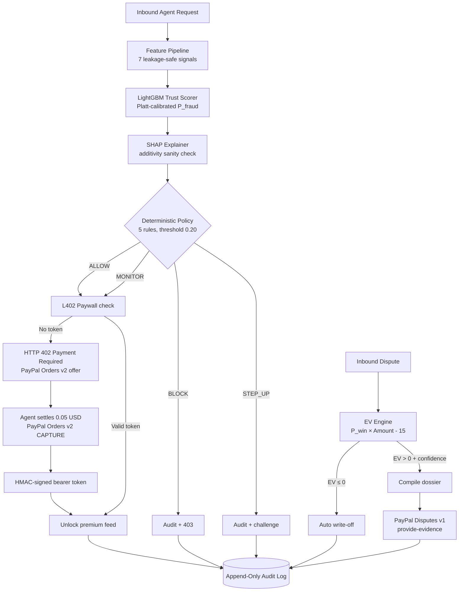

# PayShield AI

**The Pre-Transaction Trust Layer for Agentic Commerce on PayPal.**

PayShield AI is a unified trust and monetization engine that distinguishes legitimate AI agents from malicious bots at checkout, blocks card-testing fraud before capture, charges legitimate bots via an L402 PayPal paywall, and autonomously recovers disputed revenue through a policy-bounded EV engine.

> **Prototype scope.** Built for the PayPal AI Hackathon 2026 using synthetic transaction data. Not connected to a live payment processor (uses PayPal Sandbox/mocks). No authentication. Not production-hardened. See [Limitations](#limitations--prototype-scope) below for what this means for the reported metrics.

[](https://github.com/sm-daniyal/payshield-ai/actions)
[](https://opensource.org/licenses/MIT)


---

## Contents

[The problem](#the-problem) · [Architecture](#architecture) · [ML pipeline](#ml-pipeline) · [Model results](#model--evaluation-results) · [Decision engine](#decision-engine) · [Payments Security](#payments-security) · [API](#api) · [Frontend](#frontend--dashboard) · [Project structure](#project-structure) · [Testing](#testing) · [Limitations](#limitations--prototype-scope)

---

## The problem

PayPal merchants lose profit to three unaddressed problems:

1. **Card Testing Fraud:** Bots run micro-purchases to validate stolen cards. Visa estimates enumeration attacks drive $1.1B in annual fraud losses. Traditional CAPTCHAs fail against AI scrapers.
2. **The $15 Dispute Fee Trap:** PayPal assesses a non-refundable $15 fee on contested disputes. Fighting a $12 claim is a guaranteed loss: `EV = (0.50 × $12) - $15 = -$9.00`. Merchants lack the math to know when to concede.
3. **Unmonetized Bot Traffic:** Autonomous agents scrape catalogs for free, draining server bandwidth.

PayShield solves this by acting as a causal pipeline: Stage 1 (Trust Verdict) scores the transaction. Stage 2 (L402 Paywall) monetizes the legitimate bots. Stage 3 (Dispute EV) recovers revenue post-capture.

## Architecture



Three independently-auditable layers: the model estimates probability → a deterministic module converts it to a 0–100 risk score for legibility → a separate deterministic module decides the bounded action. Changing how risk is displayed can never silently change what action is taken. (See [docs/ARCHITECTURE.md](docs/ARCHITECTURE.md)).

## ML pipeline

We trained a LightGBM model on a 10,000-sample synthetic dataset (1.5% fraud rate) to demonstrate our cost-optimization pipeline. We compared it against a Logistic Regression baseline.

- **Features:** 7 engineered features (amount z-score, velocity windows, FX spread, geo mismatch, account risk).
- **Calibration:** Platt scaling to ensure probabilities are mathematically aligned with reality.
- **Thresholding:** We sweep thresholds (0.10 to 0.90) against an asymmetric financial cost function (FP penalty = $50, FN loss = 0.5 × amount).

## Model & evaluation results

All numbers are on the held-out test set (never used during model selection or threshold tuning).

| Model | Precision | Recall | F1 | ROC-AUC | FP | FN | Est. Cost (Holdout) |
| :--- | :--- | :--- | :--- | :--- | :--- | :--- | :--- |
| Logistic Regression (baseline) | 0.633 | 0.633 | 0.633 | 0.973 | 11 | 11 | $3,204.34 |
| LightGBM (selected) | 0.553 | 0.700 | 0.618 | 0.986 | 17 | 9 | $3,021.73 |

Selected operating threshold: **0.20** — chosen by minimising expected cost. If we used the default 0.5 threshold, we would have cost the merchant $4,876. By sweeping the threshold, we identified **0.20** as the cost-optimal point, saving the merchant **$1,854**.

**Honest Disclosure:** While Logistic Regression has a slightly higher F1 score, LightGBM saves the merchant money because it correctly catches more fraud (Recall 70% vs 63%). In fintech, the financial cost of a false negative far outweighs a false positive.


## Decision engine

A five-rule policy table converts a fraud probability (and transaction amount) into a bounded action recommendation. Rules fire in order; first match wins. (See [docs/DECISION_ENGINE.md](docs/DECISION_ENGINE.md)).

| Rule | Condition | Action |
| :--- | :--- | :--- |
| CRITICAL_BLOCK | probability ≥ 0.80 | BLOCK_AND_FLAG_DISPUTE |
| HIGH_STEP_UP | probability ≥ 0.40 | STEP_UP_VERIFICATION |
| MEDIUM_MONITOR | probability ≥ 0.20 | ALLOW_WITH_MONITORING |
| LOW_ALLOW | (catch-all) | ALLOW |

SHAP explanations cannot influence the action — `evaluate_policy()` accepts only `(probability, amount)`, enforced by function signature and verified by dedicated tests in `test_decision_engine.py`. (See [docs/EXPLAINABILITY.md](docs/EXPLAINABILITY.md)).

## Payments Security

- **Webhook Verification:** Every inbound PayPal webhook is verified via `/v1/notifications/verify-webhook-signature` before state mutation. Fails closed on timeout. (See `test_webhooks.py` and [docs/PAYPAL_INTEGRATION.md](docs/PAYPAL_INTEGRATION.md)).
- **Idempotency:** Every outbound PayPal POST (Orders v2 / Disputes v1) includes a `PayPal-Request-Id` header to prevent double-charging.
- **Audit Vault:** An append-only SQLite log chained via SHA-256 (`hash = SHA256(prev_hash + record)`). (See [docs/PAYMENT_SECURITY.md](docs/PAYMENT_SECURITY.md)).

## Frontend / dashboard

A React/Vite dashboard for exploring the system. You can inject a transaction manually, view the fraud probability, see the SHAP-grounded explanation, and watch the L402 paywall settle a micro-payment.


## Project structure

```text
payshield-ai/
├── backend/
│   ├── app/        # FastAPI app: routes, schemas, services
│   ├── ml/         # Training scripts, evaluation JSON, and matplotlib charts
│   └── tests/      # pytest suite: ML, API, Webhook security, L402
├── frontend/       # React 19 + Vite + Tailwind dashboard
├── docs/           # Technical documentation (see [docs/README.md](docs/README.md) for index)
├── screenshots/    # UI screenshots
├── Dockerfile      # Multi-stage build
├── docker-compose.yml # docker compose up --build
├── PayShield_AI.postman_collection.json # Postman API tests
├── .env.example
└── README.md
```

## Local setup & running the project

Prerequisites: Python 3.12+, Node.js 20+.

### Option A — Docker (Recommended)

```bash
docker-compose up --build
# http://localhost:8000 → dashboard
# http://localhost:8000/api/docs → interactive API docs
```

### Option B — Local setup

```bash
# 1. Backend
cd backend
python -m venv .venv
.venv\Scripts\activate
pip install -r requirements.txt
uvicorn app.main:app --reload

# 2. Frontend (new terminal)
cd frontend
npm install
npm run dev
# Open http://localhost:5173
```

## Testing & API Verification

We prioritize verification over claims. Our pytest suite covers webhook fail-closed behavior, ML additivity invariants, decision engine boundaries, and audit persistence.

```bash
cd backend
pytest tests/ -q
# 100+ tests passing, covering test_webhooks.py, test_ml_and_policy.py, test_feature_pipeline.py, and test_paypal_and_disputes.py.
```

### Manual API Testing (Postman)
A complete Postman collection is included at the root (`PayShield_AI.postman_collection.json`). It contains pre-configured requests for the Trust Verdict (`/api/v1/evaluate`) and the L402 Paywall flow. See `docs/POSTMAN.md` for usage instructions.

## Limitations / prototype scope

- **Synthetic data only.** The model was trained on a generator-controlled dataset to demonstrate the pipeline. No real payment data was used or claimed.
- **No live payment integration.** The system uses the PayPal Sandbox API. Every action is a recommendation label returned as data. The system cannot move actual money.
- **No authentication.** The API and dashboard have no login/access control.
- **SQLite audit storage.** Appropriate for a prototype; not a production audit solution.
- **Docker not end-to-end run-tested locally.** The `Dockerfile` and `docker-compose.yml` are provided and validated against CI base images, but development was done using local Uvicorn servers. If Docker fails on your machine, run the local setup command.
- **Cold-start transactions.** Customers with no prior history are scored neutrally. Production systems would query a live customer database.

