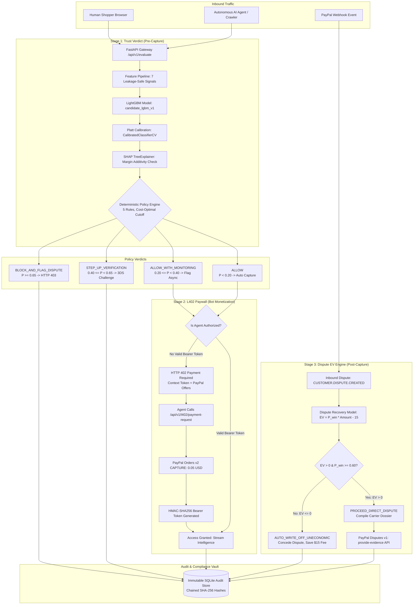

# PayShield AI — System Architecture

**The Pre-Transaction Trust Layer for Agentic Commerce on PayPal.**

---

## 1. System Overview & Problem Definition

In autonomous e-commerce and agentic commerce, PayPal merchants face three distinct failure modes:

1. **Card-Testing Fraud & Automated Enumeration:** Malicious botnets execute rapid micro-authorizations to validate stolen credentials. Traditional CAPTCHAs and biometric prompts fail because they disrupt legitimate shoppers while failing against multi-modal AI agents.
2. **The $15 Dispute Fee Trap:** PayPal assesses a non-refundable **$15.00 USD dispute fee** on every contested chargeback. Merchants attempting to fight low-dollar disputes ($10–$20) suffer negative expected value ($EV < 0$) even when winning a portion of cases.
3. **Unmonetized Autonomous Scraper Traffic:** Autonomous AI crawlers inundate merchant catalog endpoints to harvest pricing, inventory, and product data without contributing revenue.

PayShield AI resolves these challenges through a unified **3-stage causal pipeline**:

```
┌─────────────────────────────────────────────────────────────────────────────┐
│                           THE 3-STAGE CAUSAL PIPELINE                       │
├─────────────────────────────────────────────────────────────────────────────┤
│                                                                             │
│  [ STAGE 1: TRUST VERDICT ]                                                 │
│  Pre-Capture ML Scoring & Deterministic Policy                              │
│  • 7 Leakage-Safe Behavioral Signals                                        │
│  • Platt-Calibrated LightGBM Probability (P_fraud)                          │
│  • SHAP TreeExplainer Additivity Verification (Δ < 1e-4)                     │
│  • 5-Rule Bounded Policy (Threshold = 0.20 / 0.40)                          │
│                                                                             │
│                                     │                                       │
│                                     ▼                                       │
│  [ STAGE 2: L402 PAYWALL ]                                                  │
│  Autonomous Machine-to-Machine Monetization                                 │
│  • RFC 402 HTTP 402 Payment Required for Unauthenticated Bots               │
│  • PayPal Orders v2 Micro-Capture ($0.05 USD / Query)                       │
│  • HMAC-SHA256 Cryptographic Bearer Token Issuance                          │
│  • Unlocks Premium Protected Feeds for Paying AI Agents                     │
│                                                                             │
│                                     │                                       │
│                                     ▼                                       │
│  [ STAGE 3: DISPUTE EV ENGINE ]                                             │
│  Post-Capture Autonomous Dispute Recovery                                   │
│  • Expected Net Recovery: EV = (P_win × Amount) - $15.00                    │
│  • Auto-Concede Negative EV Claims (Preserves Merchant Margin)              │
│  • Auto-Submit Carrier & Postal Proof via PayPal Disputes v1                │
│                                                                             │
└─────────────────────────────────────────────────────────────────────────────┘
```

---

## 2. End-to-End Pipeline Architecture



---

## 3. Separation of Concerns Principle

PayShield AI enforces a strict architectural boundary between statistical estimation, explainability, and action execution:

```
[ LightGBM Classifier ]  ──> Probability P(fraud) in [0, 1]
                                     │
                                     ▼
[ Display Layer ]        ──> Scaled Risk Score = P × 100  (Purely for human readability)
                                     │
                                     ▼
[ Decision Engine ]      ──> evaluate_policy(P, amount)   (Stateless, deterministic mapping)
```

1. **Statistical Prediction (`app.engine.model_runner`):** LightGBM outputs unconstrained margin values transformed into calibrated probabilities $P \in [0.0, 1.0]$ via Platt scaling.
2. **Visual Score Presentation:** Risk scores ($0$–$100$) are formatted strictly for display; no downstream backend system consumes the scaled integer.
3. **Deterministic Bounded Action (`app.engine.decision_engine`):** Evaluates strictly the tuple `(probability, amount_usd)`. The decision engine has **no dependency on SHAP, prompt text, or LLM output**.
4. **Explainability (`app.engine.shap_explainer`):** Computes tree feature attributions. It has zero mutation rights over policy decisions.

---

## 4. Leakage-Safe Feature Engineering Pipeline

Every feature is derived strictly from historical data available prior to transaction authorization:

| Feature Name | Mathematical Definition | Financial Signal |
| :--- | :--- | :--- |
| `amount_zscore` | $z = \frac{x - \mu_{\text{buyer}}}{\sigma_{\text{buyer}} + \epsilon}$ | Detects atypical transaction value spikes relative to buyer baseline. |
| `velocity_1h` | $\sum \mathbb{I}(t_{\text{prev}} \ge t_{\text{now}} - 3600)$ | Captures rapid card-testing bursts and credential stuffing. |
| `velocity_24h` | $\sum \mathbb{I}(t_{\text{prev}} \ge t_{\text{now}} - 86400)$ | Detects multi-hour automated liquidation campaigns. |
| `velocity_7d` | $\sum \mathbb{I}(t_{\text{prev}} \ge t_{\text{now}} - 604800)$ | Measures weekly baseline acceleration. |
| `fx_spread` | $\frac{\lvert R_{\text{actual}} - R_{\text{benchmark}} \rvert}{R_{\text{benchmark}}}$ | Identifies cross-border currency conversion rate arbitrage. |
| `geo_mismatch` | $\mathbb{I}(\text{shipping\_country} \neq \text{ip\_country})$ | Detects proxy routing and cross-border redirection fraud. |
| `account_risk_score` | $f(\text{age}, \text{verified}, \text{disputes}) \in [0, 1]$ | Structural account maturity and historical dispute penalty. |

---

## 5. Stage 2: L402 Autonomous Machine-to-Machine Paywall

*Note: The L402 protocol was originally created by Lightning Labs for the Bitcoin Lightning Network. Our implementation adapts this HTTP 402 standard for fiat micro-settlements using the PayPal Orders v2 API.*

When autonomous AI bots, crawlers, or market-intelligence subagents query PayShield's protected feeds without authentication, the gateway executes the **RFC 402 / L402 protocol**:

1. **HTTP 402 Payment Required:**
   The gateway inspects the incoming `Authorization: Bearer <token>` header. If absent or invalid, it returns HTTP 402 with `WWW-Authenticate: L402` and a JSON challenge containing:
   - `payment_context_token`: Unique session identifier UUID.
   - `payment_request_url`: Endpoint to trigger PayPal order capture.
   - `offers`: Pricing options (e.g., `$0.05 USD` per threat intel query).
2. **Autonomous PayPal Orders v2 Settlement:**
   The bot agent sends a POST request to `/api/v1/l402/payment-request`. The gateway calls PayPal Orders v2 `CAPTURE` intent for `$0.05 USD`.
3. **Cryptographic HMAC Bearer Token:**
   Upon confirmed PayPal capture, the gateway mints an HMAC-SHA256 token:
   $$\text{token} = \text{HMAC-SHA256}(K_{\text{secret}}, \text{context\_token} \parallel \text{expiry})$$
4. **Feed Unlock (HTTP 200 OK):**
   The bot presents `Authorization: Bearer <token>` on subsequent requests. The gateway verifies the HMAC signature and serves premium structured telemetry without human intervention.

---

## 6. Stage 3: Autonomous Dispute Recovery (Disputes v1)

PayPal charges a non-refundable **$15.00 dispute fee** on contested claims. The Expected Value (EV) engine determines whether to defend or write off:

$$\text{Expected Net Recovery} = (P_{\text{win}} \times \text{Dispute Amount}) - \$15.00$$

- **Case 1 ($EV \le 0$):** Auto write-off (`AUTO_WRITE_OFF_UNECONOMIC`). The merchant concedes immediately, avoiding the $15.00 penalty and saving administrative overhead.
- **Case 2 ($EV > 0$ and $P_{\text{win}} \ge 0.60$):** Autonomous defense (`PROCEED_DIRECT_DISPUTE`). The engine compiles a structured evidence dossier (carrier tracking scans, GPS delivery confirmations, AVS/CVV matching) and transmits it via PayPal Disputes v1 `POST /v1/customer/disputes/{id}/provide-evidence`.

---

## 7. Cryptographic Audit Vault

Every decision across all three stages is committed to an append-only SQLite log with cryptographic SHA-256 hash chaining:

$$\text{Hash}_n = \text{SHA-256}(\text{Hash}_{n-1} \parallel \text{TransactionID} \parallel \text{Timestamp} \parallel P_{\text{fraud}} \parallel \text{Action} \parallel \Delta_{\text{additivity}})$$

This provides mathematical proof of non-tampering for financial compliance and banking partner review.
